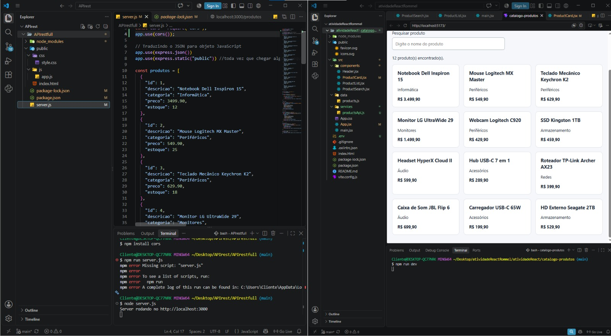
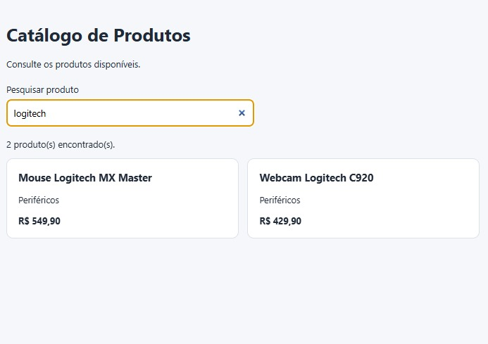
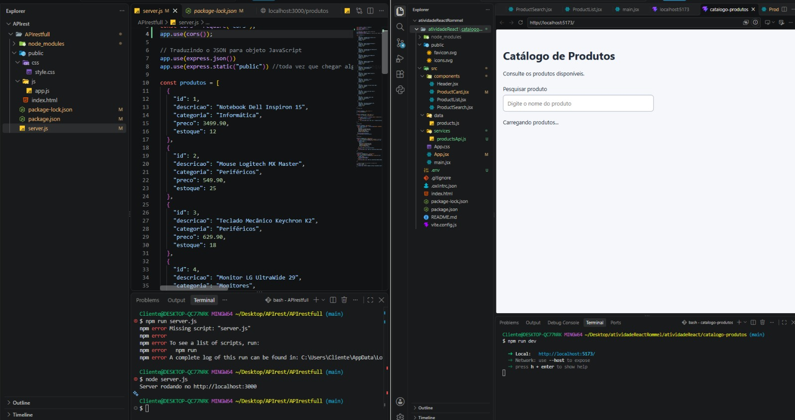
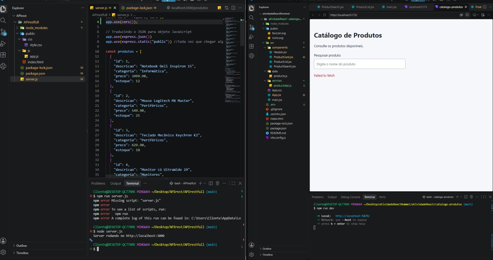
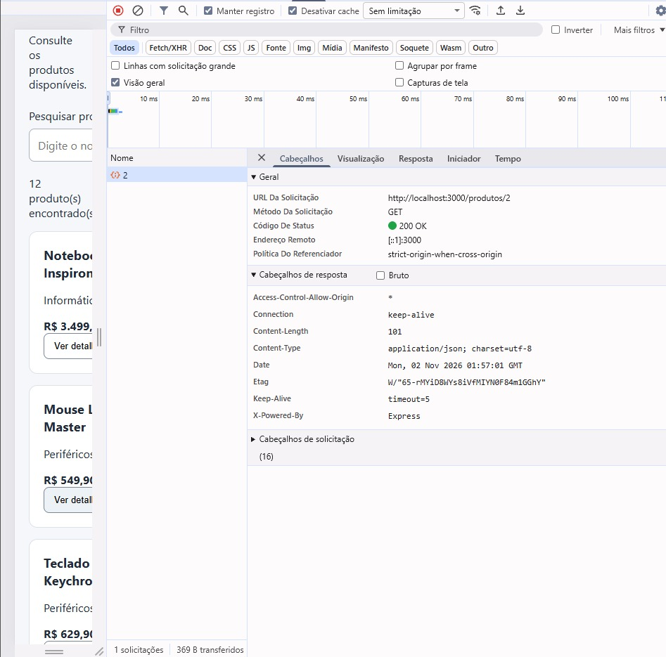

# atividadeReact
Atividade Prática - React

## Como executar

### API
```bash
git clone https://github.com/LuisFernandodeSousaDias0/APIrestfull.git
cd APIrestfull
npm install
node server.js
```
A API roda em `http://localhost:3000`.

### Front-end
Na pasta `catalogo-produtos`, crie um arquivo `.env`:
```
VITE_API_URL=http://localhost:3000
```
Depois rode:
```bash
npm install
npm run dev
```

## Árvore de componentes

```
App
├── Header
├── ProductSearch
├── ProductList
│   └── ProductCard
└── ProductDetails
```

## Fluxo de dados

O App guarda os estados da aplicação e busca os produtos na API com useEffect. O ProductSearch recebe o valor da pesquisa e a função setSearch por props, e atualiza o estado do App quando o usuário digita. Com os produtos e a pesquisa, o App calcula filteredProducts e envia essa lista para o ProductList. O ProductList usa map para criar um ProductCard para cada produto. Ao clicar em "Ver detalhes", o ProductCard chama onViewDetails com o id do produto, o que atualiza o selectedId no App. Um useEffect busca o produto na API pelo id e o ProductDetails exibe os dados.

## Verificações

1 - Verificação: explique por que `<Header />` pode ser utilizado dentro de App e qual componente é o pai nessa relação.

Resposta: `<Header />` pode ser usado dentro de app porque componentes são funções que retornam a interface , dessa forma montamos a tela usando pequenos componentes, nesse caso o header é o filho porque é o App que renderiza o Header. Dessa forma, toda vez que quisermos uma tela com o `<Header />` nós podemos chamá-lo e não ter que fazer ele denovo do zero.

2 - Verificação: adicione um quinto produto ao array. Quantos cartões aparecem? Onde a repetição dos cartões está implementada?

Resposta: Aparecem 5 cartões. A repetição dos cartões esta implementada em ProductList com o map que passa em cada produto do array e cria um `<ProductCard>`

3 - Verificação: pesquise por mouse, depois apague o texto. Explique por que o contador e a lista são atualizados juntos.

Resposta: UseState é uma variável que quando muda atualiza a tela sozinha,
const [search, setSearch] = useState(''); search é o valor que começa vazio, setSearch é a função que troca o valor
O contador e a lista mudam juntos porque os dois usam o mesmo filteredProducts, que é calculado a partir do search. Quando o search muda, os dois são atualizados ao mesmo tempo.

## Evidências dos testes

### Produtos carregados da API


### Busca por nome


### Lista vazia


### Erro com a API parada


### Detalhes do produto


### Requisição GET /produtos/:id


### Detalhes fechados


### Console sem erros
